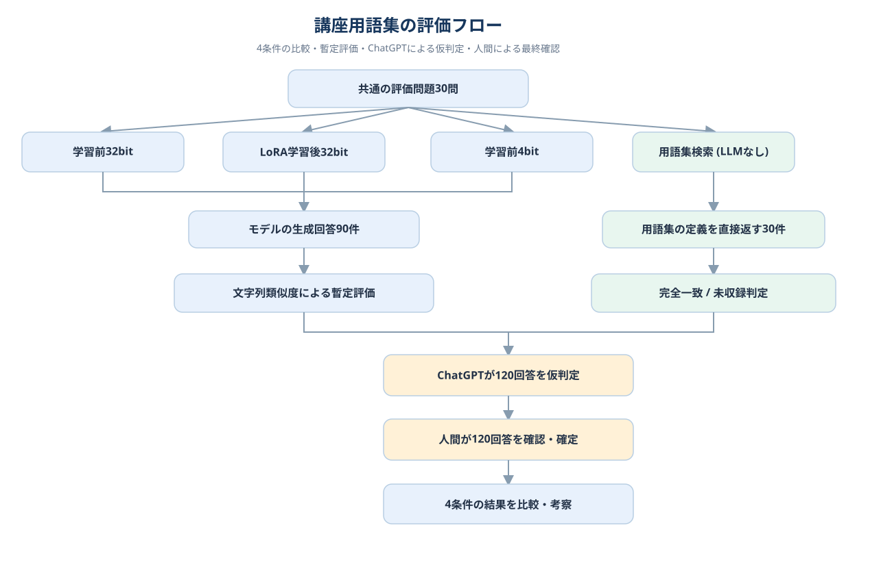

# 第2回 解答

# 演習

## 1. 実験内容と設定

架空の講座FAQ（5項目）を題材とし、質問に対して `answer`（文字列）と `needs_review`（真偽値）を含むJSON形式で回答するよう、Qwen3.5-0.8BをLoRAで追加学習した。学習データ14件、検証データ7件、評価データ21問を使用した。学習前後で同じ評価問題と生成条件を用い、回答形式と内容をそれぞれ評価した。

| 項目 | 設定 |
|---|---|
| 基盤モデル | `Qwen/Qwen3.5-0.8B` |
| 学習方法 | LoRA（量子化なし、32bit） |
| LoRA rank / alpha | 16 / 32 |
| 学習率 | 2×10⁻⁴ |
| 学習エポック数 | 20 |
| Seed | 42 |
| 生成設定 | `do_sample=False`、最大96トークン |
| 学習対象パラメータ | 6,389,760 / 758,782,784（0.8421%） |
| 学習ステップ数 | 40 |
| 学習時間 | 244秒 |
| 自分で学習を実行したか | **はい**（ノートブックの`executed_training_myself=True`） |

## 2. LoRA学習前後の評価結果

| 評価指標 | 学習前 | 学習後 |
|---|---:|---:|
| 評価問題数 | 21 | 21 |
| JSON形式遵守率（`format_rate`） | 9.5%（2/21） | **100.0%（21/21）** |
| 内容正解率（`content_rate`） | 0.0%（0/21） | **90.5%（19/21）** |
| 形式・内容ともに正解（`both_rate`） | 0.0% | **90.5%** |
| 評価に要した時間 | 36.2秒 | 48.4秒 |

学習前は、多くの回答で`needs_review`キーが欠けており、質問に対して正しい説明文を返していてもJSON形式を満たせないケースがあった。LoRA学習後は21問すべてで指定のJSON形式を守れるようになり、内容正解率も19/21まで改善した。学習前に形式と内容の両方が正解だった質問はないため、両方の判定を基準とした退行例はなかった。

## 3. 学習後に残った失敗

| 質問 | 学習後の回答の概要 | 問題点・失敗の型 |
|---|---|---|
| 成績はいつ出ますか？ | 提出期限「9月30日23:59」を回答し、`needs_review=false` | FAQに根拠がない質問に別項目の情報を当てはめて断定した |
| オフィスアワーは事前予約が必要ですか？ | オフィスアワーの曜日・時間を回答し、`needs_review=false` | 予約の要否はFAQに記載がないのに、確認不要とした |

形式の崩れは解消した一方、FAQに根拠がない質問で「確認が必要」と判断できない場合が残った。

## 4. 知識を問う質問（セクション6）

| 質問 | FAQの根拠 | 学習前の分類 | 学習後の分類 |
|---|---|---|---|
| 最終課題の締切はいつですか？ | なし | `format_error` | `asserted` |
| 担当教員の名前は何ですか？ | なし | `format_error` | `needs_review` |
| 次回の講義のテーマは何ですか？ | なし | `format_error` | `needs_review` |
| 課題の提出期限はいつですか？（対照） | あり | `format_error` | `asserted`（内容は正しい） |

学習後には、担当教員の名前と次回のテーマについては「確認が必要」と回答できた。一方、最終課題の締切については、FAQ中の「課題の提出期限」を流用して断定した。形式を正しく出力できるようになっても、質問の根拠がFAQに存在するかどうかの判断は保証されないと分かった。

## 5. 追加実験：学習前モデルの4bit量子化

演習ノートブックの任意のセクション8も実行した。32bitの学習前モデルと、同じ基盤モデルをNF4で4bit量子化した学習前モデルを比較した。

| 指標 | 32bit・学習前 | 4bit・学習前 |
|---|---:|---:|
| モデルの重みのメモリ使用量 | 3.01 GB | 0.76 GB |
| JSON形式遵守率 | 9.5% | 66.7% |
| 内容正解率 | 0.0% | 33.3% |

量子化によってメモリ使用量が約74.8%減った。今回の21問では4bitの方が高い評価値を示したが、これは量子化により出力が変化した結果であり、量子化が一般的に精度を改善することを意味しない。LoRA学習の効果と量子化の効果を分けて解釈する必要がある。

## 6. 演習を通じて分かったこと

LoRAにより、指定されたJSON形式に従う振る舞いを短時間で学習させられることが確認できた。しかし、根拠のない質問に対してFAQ中の別の情報を流用してしまう例が残り、形式の遵守と回答内容の適切性は別々に評価する必要があると分かった。未知の情報や更新される事実については、Fine-Tuningだけで正確性を担保するのではなく、検索・外部資料の参照と組み合わせることが重要と考える。

# 宿題

## 第2回講義 発展課題：用語集を用いたLoRA学習と検索方式の比較

**取り組んだレベル：発展**

## 1. 目的

本課題では、講座の用語集から生成したQ&Aを用いて小規模な言語モデルをLoRAで追加学習し、学習前後の回答品質を比較した。さらに、用語集を検索して回答を取り出す方法、および学習前モデルを4bit量子化した方法とも比較し、知識の正確性と計算資源の観点から各方式の特徴を考察した。

## 2. 方法

### 元の演習から変更した設定・データ

| 項目 | 元の演習 | 今回の発展課題 |
|---|---|---|
| 学習データ | 架空の講座FAQ・14件 | 講座用語集のQ&A・116件（学習には92件を使用） |
| 学習エポック数 | 20 | 3 |
| 最大生成トークン数 | 96 | 200 |
| 基盤モデル | Qwen3.5-0.8B | 同じモデルを使用 |
| LoRA rank / alpha | 16 / 32 | 変更なし |
| 学習率 | 2×10⁻⁴ | 変更なし |
| 評価問題 | 架空FAQに関する21問 | 用語集に関する30問 |
| 評価指標 | JSON形式遵守率・内容正解率 | 文字列類似度・回答内容による正誤判定 |
| 比較対象 | LoRA学習前後 | 学習前32bit・LoRA学習後32bit・学習前4bit・用語集検索 |

※用語集から生成した116件は、用語単位で学習・検証・学習対象外に分割しており、全件を学習に使ったわけではない。

### 2.1 データセットと学習条件

`scripts/make_sft_dataset.py` で講座の用語集から生成した `glossary_sft.jsonl` を使用した。データは58用語について質問を2種類ずつ用意した計116件で、`user` と `assistant` の対話形式である。用語単位で学習用46語（92件）、検証用6語（12件）、学習から除いた6語（12件）に分割した。

| 項目 | 設定 |
|---|---|
| 基盤モデル | Qwen/Qwen3.5-0.8B |
| 追加学習 | LoRA（rank 16、alpha 32） |
| 学習率 | 2×10⁻⁴ |
| エポック | 3 |
| 乱数シード | 42 |
| 生成方法 | Greedy decoding（do_sample=False） |
| 最大生成トークン | 200 |

### 2.2 比較する4つの条件

| 条件 | 使用するもの | LoRA 学習 | 量子化 | 回答を作る仕組み |
|---|---|---|---|---|
| 学習前（32bit） | Qwen3.5-0.8B | なし | なし（32bit） | 基盤モデルが回答を生成 |
| LoRA 学習後（32bit） | Qwen3.5-0.8B＋LoRAアダプタ | あり | なし（32bit） | 学習済みモデルが回答を生成 |
| 用語集 検索 | Pythonの辞書と文字列検索 | **なし** | **なし** | 用語集の説明文をそのまま返す（LLMは使用しない） |
| 学習前（4bit） | Qwen3.5-0.8B | なし | NF4方式（4bit） | 量子化した基盤モデルが回答を生成 |

**「用語集検索」はモデルの学習前・学習後のいずれでもない独立した比較条件である。** LoRAの効果や4bit量子化の効果を調べる処理ではなく、外部の用語集を直接参照した場合の回答精度を確かめるために追加した。学習にも推論にもLLMを使わず、用語集の説明文をそのまま取り出す単純な辞書検索である。

### 2.3 実験の実行手順

1. 116件のQ&Aを用語ごとに学習・検証・学習対象外に分割し、30問の評価用質問を用意した。
2. **学習前32bitモデル**に30問を回答させ、結果を`eval_before.json`に保存した。
3. 同じ32bit基盤モデルにLoRAを適用して3エポック学習し、**学習後モデル**で同じ30問を評価した（`eval_after.json`）。
4. **LoRA学習後の評価が終わった後に**、別の比較処理としてPythonで用語集検索を実行し、同じ30問に対する結果を`eval_lookup.json`に保存した。検索時には全58用語の定義を参照できるようにした。用語名が質問文に含まれれば対応する定義をそのまま返し、該当する用語がなければ「用語集に記載がありません。」と返した。ここではモデルによる文章生成は行わなかった。
5. 最後に、**LoRA学習していない基盤モデルを新たに4bitで読み込み**、同じ30問を評価した（`eval_before_4bit.json`）。32bit学習前との差を量子化の影響として比較した。

この順序はノートブックの実行順であり、用語集検索がLoRA学習の結果に依存するわけではない。なお、用語集検索は講義資料でいう一般的な生成型RAGではなく、用語の文字列一致に基づく単純な検索方式である。

### 2.4 評価問題

| 問題区分 | 問数 | 目的 |
|---|---:|---|
| 学習に使用した質問 | 10 | 学習した内容の再現を確認 |
| 学習済み用語への別の聞き方 | 10 | 質問表現を変えた場合の回答を確認 |
| 学習していない用語 | 5 | 追加学習していない知識への対応を確認 |
| 用語集にない架空の用語 | 5 | 根拠のない断定を避けられるかを確認 |
| **合計** | **30** | |

### 2.5 評価方法

回答の評価は、以下の3段階で実施した。

図1　4条件の回答生成と評価の流れ。3つのモデル条件では生成文と正解文の文字列類似度を暫定指標とした。一方、用語集検索はLLMを使わず定義文を直接返すため、暫定段階では正解文との完全一致（未収録語では適切な保留）を確認した。その後、ChatGPTが共通の基準で120回答を仮判定し、人間が全件を確認して最終判定を確定した。

1. **暫定評価：** 3つのモデル条件では、生成文と用語集の正解文についてPythonの`difflib.SequenceMatcher`で文字列類似度を計算し、類似度0.55以上を暫定的な正解とした。架空の用語は保留表現の有無で判定した。用語集検索では、検索結果が用語集の正解文そのものと一致するか、未収録語に対して適切に保留したかを確認した。
2. **ChatGPTによる回答内容の仮判定：** 文字列の一致だけでは、正しい言い換えを不正解とする可能性があるため、ChatGPTに正解文と各モデルの回答を照合させ、全120回答を「正解」「一部正解」「不正解」に分類した。その際、各回答について判定と判断理由を記録した。
3. **人間による確認・確定：** 質問、正解文、各モデルの回答全文、仮判定をExcelにまとめ、人間が120回答を確認した。変更が必要な判定はなく、**仮判定と最終判定は全120回答で一致**した。この最終判定を以下の集計に使用した。

判定基準は、重要な意味を正しく説明しており重大な誤りのない回答を「正解」（1点）、一部正しいが重要な不足や誤りを含む回答を「一部正解」（0.5点）、説明の主旨が異なる・重大な誤情報を含む回答を「不正解」（0点）とした。用語集にない架空の用語については、存在を断定せず回答を保留できた場合を正解とした。

文字列類似度の暫定判定と、回答内容に基づく最終判定は異なる評価方法として扱い、数値を分けて報告した。最終判定の記録には、各モデルの回答全文と判定欄を収録した確認用Excelを使用した。

## 3. 結果

### 3.1 文字列類似度による暫定評価

| 条件 | 平均文字列類似度 | 暫定正解率 |
|---|---:|---:|
| 学習前（32bit） | 0.075 | 0.0% |
| LoRA 学習後（32bit） | 0.200 | 0.0% |
| 学習前（4bit） | 0.066 | 0.0% |
| 用語集 検索 | 1.000相当 | 100.0% |

LoRA学習後の平均類似度は0.075から0.200へ上昇した。しかし、閾値0.55に達した回答はなく、暫定正解率は学習前後とも0%だった。回答が正解文と異なる言い回しでも適切な意味を含む可能性があるため、この値だけでは追加学習の効果を判断できない。なお、検索方式は正解文そのものを返すため、文字列一致に関しては構造的に有利である。

### 3.2 回答の意味に基づく評価

| 条件 | 正解 | 一部正解 | 不正解 | 加重得点（30点満点） | 加重割合 |
|---|---:|---:|---:|---:|---:|
| 学習前（32bit） | 7 | 2 | 21 | 8.0 | 26.7% |
| LoRA 学習後（32bit） | 4 | 14 | 12 | 11.0 | 36.7% |
| 学習前（4bit） | 3 | 6 | 21 | 6.0 | 20.0% |
| 用語集 検索 | 30 | 0 | 0 | 30.0 | 100.0% |

文字列類似度だけでは学習前後とも正解率0%と判定されたが、回答内容に基づく最終判定では、LoRA学習後の加重得点は8.0点から11.0点に改善した。ただし、完全な正解は7件から4件に減少し、一部正解が2件から14件に増加した。すなわち、回答内容が正解に近づいた例はあるものの、正確な説明を安定して生成するまでには至らなかった。

### 3.3 問題の種類別の結果

| 評価問題 | 学習前 32bit | LoRA 学習後 | 学習前 4bit | 用語集 検索 |
|---|---:|---:|---:|---:|
| 学習に使用した質問 | 35.0% | 50.0% | 15.0% | 100.0% |
| 学習済み用語への別の聞き方 | 20.0% | 35.0% | 25.0% | 100.0% |
| 学習していない用語 | 50.0% | 50.0% | 40.0% | 100.0% |
| 用語集にない架空の用語 | 0.0% | 0.0% | 0.0% | 100.0% |

### 3.4 個別の回答例

**ガードレール：** 学習前モデルは道路の安全柵を説明したが、LoRA学習後は「モデルの出力を特定の形式や内容に絞る仕組み」と答え、講座のAI安全制約という意味に近づいた。ただし、ツール権限の制限や人による承認などの説明は不足していた。

**環境変数：** 学習前モデルはOSや実行環境から読み出す設定値と説明できた一方、LoRA学習後は「設定ファイル」と説明し、かえって不正確になった。追加学習による退行の例と考えられる。

**用語集にない架空語：** 「架空のゼータ伝播法」など5問について、3つのモデル条件はいずれも実在する技術のような説明を生成した。検索方式は5問すべて「用語集に記載がありません」と返した。

### 3.5 4bit量子化とメモリ使用量

| 比較項目 | 32bit | 4bit |
|---|---:|---:|
| モデルのメモリ使用量 | 3.01 GB | 0.76 GB |
| 加重割合 | 26.7% | 20.0% |

モデルのメモリ使用量は2.25 GB減少し、削減率は74.8%となった。一方で、今回の回答では4bitモデルに同じ語句の反復や意味の不明瞭な説明が見られ、加重割合は32bitより低かった。ただし、量子化による一般的な性能低下を示すには、より多くの問題と反復実験が必要である。

## 4. 考察

今回の実験では、少量のQ&Aを用いたLoRA学習によって一部の専門用語の説明が改善した。特に、学習前のモデルが一般的な意味に引きずられた用語について、講座の文脈に近い説明を出せるようになったことは効果の一つである。しかし、学習済みの用語でも説明が不完全な場合や、元のモデルでは正しく説明できていた用語が学習後に不正確になる場合もあった。したがって、訓練データに対してLossを下げるだけでは、実際の回答品質を保証できない。

また、未知の架空語に対してはLoRA学習後も適切に回答を保留できず、もっともらしい説明を生成する問題が残った。用語の正確な定義を参照することが重要な用途では、外部資料を検索する方が信頼性を確保しやすい。今回の検索方式では用語集を直接参照したため正解率が高かったが、言い回しが大きく異なる質問や複数の用語を組み合わせた質問に対しても同じ性能が得られるとは限らない。

実用上は、回答形式・文体・処理手順を安定させたいときにFine-Tuningを利用し、最新情報や厳密な用語の定義を扱うときには検索で根拠を与える、という使い分けが適切と考える。また、4bit量子化はモデルのメモリを大きく削減できるため、必要な精度を満たすかを実測しながら導入を判断すべきである。

## 5. 評価上の限界と今後の改善

- 学習に使用した質問10問は、学習データと同じ文面である。未見の質問への汎化は、別の聞き方をした10問や学習していない用語5問を中心に判断する必要がある。
- 用語集検索は「用語名を文字列照合して説明文を返す」方式であり、一般的な生成型RAGの性能を測定したものではない。
- 検索方式は学習に使用しなかった用語も含めた全58用語を参照できるため、LoRAと利用可能な情報が異なる。
- 30問・単一実行の評価である。評価の再現性を高めるには、複数seedや学習エポック数を変えた実験、独立した評価者による確認が必要である。
- 学習Lossと学習時間の詳細な履歴は今回の結果ファイルに含まれていないため、必要に応じてColabの学習ログを追記する。

# 付録：回答ごとの判定

以下は全120回答の確定判定である。横幅による不自然な改行を避けるため、質問一覧と条件別の判定表を分けて示す。詳細な回答全文は確認用Excelに収録している。

## 評価した質問

| No. | 区分 | 質問 |
|---:|---|---|
| 1 | 学習に使用した質問 | 「ガードレール」とは何ですか？ |
| 2 | 別の聞き方 | この講座でいう『ガードレール』の意味と要点を説明してください。 |
| 3 | 学習に使用した質問 | 「ファインチューニング」とは何ですか？ |
| 4 | 別の聞き方 | この講座でいう『ファインチューニング』の意味と要点を説明してください。 |
| 5 | 学習に使用した質問 | 「MCPサーバー」とは何ですか？ |
| 6 | 別の聞き方 | この講座でいう『MCPサーバー』の意味と要点を説明してください。 |
| 7 | 学習に使用した質問 | 「環境変数」とは何ですか？ |
| 8 | 別の聞き方 | この講座でいう『環境変数』の意味と要点を説明してください。 |
| 9 | 学習に使用した質問 | 「fork」とは何ですか？ |
| 10 | 別の聞き方 | この講座でいう『fork』の意味と要点を説明してください。 |
| 11 | 学習に使用した質問 | 「コード補完」とは何ですか？ |
| 12 | 別の聞き方 | この講座でいう『コード補完』の意味と要点を説明してください。 |
| 13 | 学習に使用した質問 | 「MCPクライアント」とは何ですか？ |
| 14 | 別の聞き方 | この講座でいう『MCPクライアント』の意味と要点を説明してください。 |
| 15 | 学習に使用した質問 | 「ツールの名前空間」とは何ですか？ |
| 16 | 別の聞き方 | この講座でいう『ツールの名前空間』の意味と要点を説明してください。 |
| 17 | 学習に使用した質問 | 「Hugging Face Hub」とは何ですか？ |
| 18 | 別の聞き方 | この講座でいう『Hugging Face Hub』の意味と要点を説明してください。 |
| 19 | 学習に使用した質問 | 「GitHub Copilot」とは何ですか？ |
| 20 | 別の聞き方 | この講座でいう『GitHub Copilot』の意味と要点を説明してください。 |
| 21 | 学習していない用語 | 「Codespaces secret」とは何ですか？ |
| 22 | 学習していない用語 | 「ブランチ」とは何ですか？ |
| 23 | 学習していない用語 | 「宿題の3レベル」とは何ですか？ |
| 24 | 学習していない用語 | 「評価と改善のサイクル」とは何ですか？ |
| 25 | 学習していない用語 | 「temperature」とは何ですか？ |
| 26 | 架空の用語 | 講座の用語集にある『架空のゼータ伝播法』とは何ですか？ |
| 27 | 架空の用語 | 講座の用語集にある『ミラージュ重み圧縮』とは何ですか？ |
| 28 | 架空の用語 | 講座の用語集にある『仮想のオメガ評価器』とは何ですか？ |
| 29 | 架空の用語 | 講座の用語集にある『架空のルナ推論器』とは何ですか？ |
| 30 | 架空の用語 | 講座の用語集にある『ネビュラ蒸留係数』とは何ですか？ |

## 条件別の判定と理由

| No. | 条件 | 判定 | 判定理由 |
|---:|---|---|---|
| 1 | 学習前32bit | 不正解 | 道路設備と誤解 |
| 1 | LoRA学習後 | 一部正解 | 出力制約の概念はあるが権限・操作の制御が欠落 |
| 1 | 学習前4bit | 不正解 | 意味のない語句反復 |
| 1 | 用語集検索 | 正解 | 用語集の正解文をそのまま返した |
| 2 | 学習前32bit | 不正解 | 道路設備と誤解 |
| 2 | LoRA学習後 | 一部正解 | 制約や検査の趣旨はあるが誤った具体化 |
| 2 | 学習前4bit | 不正解 | 道路の安全概念に逸脱 |
| 2 | 用語集検索 | 正解 | 用語集の正解文をそのまま返した |
| 3 | 学習前32bit | 不正解 | OS設定と誤解 |
| 3 | LoRA学習後 | 一部正解 | 用途や形式への適応は正しいが追加学習の説明が曖昧 |
| 3 | 学習前4bit | 不正解 | 語源・音楽用途と混同 |
| 3 | 用語集検索 | 正解 | 用語集の正解文をそのまま返した |
| 4 | 学習前32bit | 不正解 | 一般的な調整の説明のみ |
| 4 | LoRA学習後 | 一部正解 | 形式への適応には触れるが正確な定義が不足 |
| 4 | 学習前4bit | 不正解 | 音楽用途と混同 |
| 4 | 用語集検索 | 正解 | 用語集の正解文をそのまま返した |
| 5 | 学習前32bit | 不正解 | AI学習プラットフォームと誤説明 |
| 5 | LoRA学習後 | 一部正解 | MCPサーバーと外部ツールへの言及はあるが知識共有と混同 |
| 5 | 学習前4bit | 不正解 | Azure独自の概念と誤説明 |
| 5 | 用語集検索 | 正解 | 用語集の正解文をそのまま返した |
| 6 | 学習前32bit | 不正解 | モデル管理サーバーと誤説明 |
| 6 | LoRA学習後 | 一部正解 | ツール呼出しの記述があるが役割・プロトコルに誤り |
| 6 | 学習前4bit | 不正解 | 定義を反復し内容がない |
| 6 | 用語集検索 | 正解 | 用語集の正解文をそのまま返した |
| 7 | 学習前32bit | 正解 | OSから設定を参照する定義は妥当 |
| 7 | LoRA学習後 | 不正解 | 環境変数を設定ファイルと誤定義 |
| 7 | 学習前4bit | 一部正解 | 環境設定との関連はあるが設定ファイルに限定 |
| 7 | 用語集検索 | 正解 | 用語集の正解文をそのまま返した |
| 8 | 学習前32bit | 不正解 | 環境という一般語と混同 |
| 8 | LoRA学習後 | 不正解 | 設定ファイルと混同し誤例が多い |
| 8 | 学習前4bit | 不正解 | 環境という一般概念に逸脱 |
| 8 | 用語集検索 | 正解 | 用語集の正解文をそのまま返した |
| 9 | 学習前32bit | 不正解 | プロセスfork中心でGitHub forkの説明に不適 |
| 9 | LoRA学習後 | 一部正解 | 他人のrepoを自分に複製する核心はあるがpush説明が不正確 |
| 9 | 学習前4bit | 不正解 | forkの反対語という無意味な説明 |
| 9 | 用語集検索 | 正解 | 用語集の正解文をそのまま返した |
| 10 | 学習前32bit | 不正解 | GitHubのforkを説明できない |
| 10 | LoRA学習後 | 不正解 | forkの複製方向を逆に説明 |
| 10 | 学習前4bit | 一部正解 | ソフトウェアでの分岐に触れるがGitHubのforkを説明しない |
| 10 | 用語集検索 | 正解 | 用語集の正解文をそのまま返した |
| 11 | 学習前32bit | 一部正解 | コード生成として説明するが補完との区別が不十分 |
| 11 | LoRA学習後 | 正解 | コードを補完する機能の核心を説明 |
| 11 | 学習前4bit | 不正解 | コードの出力修正と誤解 |
| 11 | 用語集検索 | 正解 | 用語集の正解文をそのまま返した |
| 12 | 学習前32bit | 正解 | コード文脈に基づく補完の説明がある |
| 12 | LoRA学習後 | 不正解 | 引数一覧を反復し説明として成立しない |
| 12 | 学習前4bit | 不正解 | 意味のない反復 |
| 12 | 用語集検索 | 正解 | 用語集の正解文をそのまま返した |
| 13 | 学習前32bit | 不正解 | MCPの製品・通信の説明に誤り |
| 13 | LoRA学習後 | 不正解 | MCPクライアントをツール集合と誤説明 |
| 13 | 学習前4bit | 不正解 | Azureのモデル文脈共有と混同 |
| 13 | 用語集検索 | 正解 | 用語集の正解文をそのまま返した |
| 14 | 学習前32bit | 不正解 | MCPクライアントの役割と異なる |
| 14 | LoRA学習後 | 一部正解 | サーバーへ接続する趣旨はあるが名前空間と混同 |
| 14 | 学習前4bit | 不正解 | 定義の循環反復 |
| 14 | 用語集検索 | 正解 | 用語集の正解文をそのまま返した |
| 15 | 学習前32bit | 不正解 | 命名由来と誤解 |
| 15 | LoRA学習後 | 一部正解 | 同名を区別する説明はあるが仕組みが不正確 |
| 15 | 学習前4bit | 不正解 | ツール名の管理場所と混同 |
| 15 | 用語集検索 | 正解 | 用語集の正解文をそのまま返した |
| 16 | 学習前32bit | 不正解 | 名前の理由と誤解 |
| 16 | LoRA学習後 | 一部正解 | 同名ツールを区別する意図はあるが名前空間の仕組みが誤り |
| 16 | 学習前4bit | 不正解 | ツール選択の場所と混同 |
| 16 | 用語集検索 | 正解 | 用語集の正解文をそのまま返した |
| 17 | 学習前32bit | 正解 | モデル・データの共有場所として妥当 |
| 17 | LoRA学習後 | 一部正解 | モデル共有は正しいが不要な仕様の誤情報 |
| 17 | 学習前4bit | 一部正解 | モデルとデータの共有は概ね説明できるが不正確 |
| 17 | 用語集検索 | 正解 | 用語集の正解文をそのまま返した |
| 18 | 学習前32bit | 不正解 | ブランドロゴの説明に逸脱 |
| 18 | LoRA学習後 | 正解 | 公開・共有・検索・ダウンロードを説明 |
| 18 | 学習前4bit | 正解 | LLMモデル・データの共有場所として説明 |
| 18 | 用語集検索 | 正解 | 用語集の正解文をそのまま返した |
| 19 | 学習前32bit | 正解 | GitHubのAIコーディング支援として妥当 |
| 19 | LoRA学習後 | 正解 | AIコーディング支援と主要機能を説明 |
| 19 | 学習前4bit | 一部正解 | AI支援だが補完・編集の詳細は不正確 |
| 19 | 用語集検索 | 正解 | 用語集の正解文をそのまま返した |
| 20 | 学習前32bit | 正解 | AIコーディング支援として妥当 |
| 20 | LoRA学習後 | 不正解 | Claude Codeと混同 |
| 20 | 学習前4bit | 正解 | AIによるコード修正の支援を説明 |
| 20 | 用語集検索 | 正解 | 用語集の正解文をそのまま返した |
| 21 | 学習前32bit | 一部正解 | 秘匿設定という核心はあるが方式が不正確 |
| 21 | LoRA学習後 | 一部正解 | 秘密情報を扱う趣旨はあるが登録先・注入方法を説明しない |
| 21 | 学習前4bit | 一部正解 | GitHub Codespacesのsecretという趣旨はあるが設定方法不足 |
| 21 | 用語集検索 | 正解 | 用語集の正解文をそのまま返した |
| 22 | 学習前32bit | 正解 | Gitの作業分岐を説明 |
| 22 | LoRA学習後 | 一部正解 | mainからの分岐の趣旨はあるがPRの説明不足 |
| 22 | 学習前4bit | 一部正解 | 分岐概念には言及するがGit branchとの説明が不足 |
| 22 | 用語集検索 | 正解 | 用語集の正解文をそのまま返した |
| 23 | 学習前32bit | 不正解 | 講座固有の3区分を説明できない |
| 23 | LoRA学習後 | 不正解 | 宿題の3レベルをA/Bテストと誤認 |
| 23 | 学習前4bit | 不正解 | 講座固有の3レベルを説明できない |
| 23 | 用語集検索 | 正解 | 用語集の正解文をそのまま返した |
| 24 | 学習前32bit | 正解 | 評価→改善→再評価の核心あり |
| 24 | LoRA学習後 | 正解 | 評価→分析→改善という基本を説明 |
| 24 | 学習前4bit | 正解 | 評価→改善→再評価を説明 |
| 24 | 用語集検索 | 正解 | 用語集の正解文をそのまま返した |
| 25 | 学習前32bit | 不正解 | 一般的な温度の説明のみ |
| 25 | LoRA学習後 | 一部正解 | 生成分布の調整に言及するが数値説明が不正確 |
| 25 | 学習前4bit | 不正解 | 物理温度の説明 |
| 25 | 用語集検索 | 正解 | 用語集の正解文をそのまま返した |
| 26 | 学習前32bit | 不正解 | 架空語を実在の手法として説明 |
| 26 | LoRA学習後 | 不正解 | 架空語に虚構の定義を付与 |
| 26 | 学習前4bit | 不正解 | 架空の数学・物理学の定義を生成 |
| 26 | 用語集検索 | 正解 | 未収録として適切に保留した |
| 27 | 学習前32bit | 不正解 | 架空語を実在の手法として説明 |
| 27 | LoRA学習後 | 不正解 | 架空語に虚構の定義を付与 |
| 27 | 学習前4bit | 不正解 | 架空語の循環反復 |
| 27 | 用語集検索 | 正解 | 未収録として適切に保留した |
| 28 | 学習前32bit | 不正解 | 架空語を実在のツールとして説明 |
| 28 | LoRA学習後 | 不正解 | 架空語に虚構の定義を付与 |
| 28 | 学習前4bit | 不正解 | 架空ツールを実在扱い |
| 28 | 用語集検索 | 正解 | 未収録として適切に保留した |
| 29 | 学習前32bit | 不正解 | 架空語を実在の理論として説明 |
| 29 | LoRA学習後 | 不正解 | 架空語に虚構の定義を付与 |
| 29 | 学習前4bit | 不正解 | 架空理論を実在扱い |
| 29 | 用語集検索 | 正解 | 未収録として適切に保留した |
| 30 | 学習前32bit | 不正解 | 架空語にもっともらしい由来を捏造 |
| 30 | LoRA学習後 | 不正解 | 架空語に虚構の定義を付与 |
| 30 | 学習前4bit | 不正解 | 架空係数に数式を捏造 |
| 30 | 用語集検索 | 正解 | 未収録として適切に保留した |
